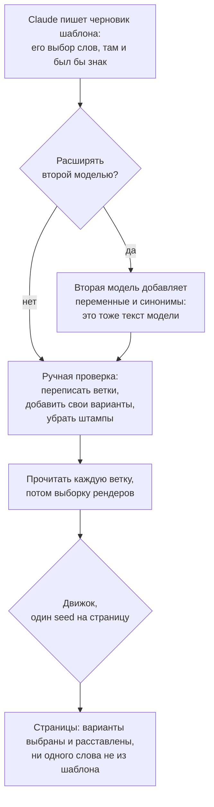

# Водяной знак Claude и шаблоны spintax: кто написал эти слова

С 16 ноября ещё четыре модели Claude маркируют текст. Какие правки, по словам Anthropic, выдерживает знак и из чего состоит шаблон, отрендеренный 1 000 раз.

Source: https://ru.spintax.site/claude-text-watermark-and-spintax-templates/
Published: 2026-11-05
Facts checked: 2026-11-05

---

4 ноября 2026 года Anthropic разослала клиентам Claude Platform письмо: 16 ноября она начнёт
ставить водяной знак на текст Claude Opus 4.6, Opus 4.5, Sonnet 4.5 и Haiku 4.5, а на
Amazon Bedrock раскатка «may take a few additional days». Для Opus 4.6 дату перенесли:
«starting from November 16, not November 3, as we had previously communicated». Все модели,
вышедшие после 2 августа 2026 года, несут знак с первого дня. Причина названа прямо — EU AI
Act: Anthropic распространяет знак на старые модели «ahead of the December deadline, so it's
in place for customers working through their own obligations».

Если Claude встроен в ваш процесс производства контента, возникают два вопроса. Попадёт ли
маркировка на страницы? И второй, который набирают в поиске: можно ли убрать водяной знак
ИИ из текста, пропустив текст через шаблон? Статья отвечает на оба тем, что Anthropic
опубликовала, и тем, что можно измерить на шаблоне без доступа к детектору.

## Что такое водяной знак, словами Anthropic

В письме он описан одной фразой:

> The watermark is an imperceptible pattern in word choice.

[Документация для разработчиков](https://platform.claude.com/docs/en/build-with-claude/text-watermark)
добавляет, что знак «adds no tokens or hidden characters and carries no information about
you or your organization». Символов нулевой ширины и трюков с Unicode, которые можно было
бы найти при чистке текста, здесь нет. Знак — в том, какие слова выбраны.

Для четырёх старых моделей в письме указано условие: знак «is applied only when temperature,
top_p, and top_k are at their default settings», а ответы на запросы с другими значениями
«may not be watermarked». Совет Anthropic адресован тем, кто на знак опирается: оставить
значения по умолчанию. У Claude Opus 4.7 и новее выбирать нечего: как цитировала
[статья про описания товаров](/why-ai-product-descriptions-sound-the-same/), установка
этих параметров «to any non-default value on Claude Opus 4.7 or later models» возвращает
ошибку 400.

Обнаружение водяного знака пока доступно в закрытом превью.
[Статья поддержки](https://support.claude.com/en/articles/16266773-how-claude-marks-ai-generated-content)
перечисляет, кто может подать заявку: «regulators, law enforcement, media, fact-checkers,
independent researchers, educational organizations, and EU civil society groups», а также
«enterprises that need to check marks on their own Claude outputs». Публичной проверки для
текста нет. У нас доступа нет, так что ниже нет ни одного результата детектора.

## Какие правки, по словам Anthropic, выдерживает знак

Статья поддержки описывает и сохранение знака, и его отсутствие. О сохранении:

> Because the watermark is part of the text, it will travel with the text when it's copied and pasted elsewhere, and may persist through some editing.

Об отсутствии: знак может не найтись, если «the text has been heavily edited, paraphrased,
translated, or mixed into other writing» или если фрагмент слишком короткий, «leaving too
little text for a reliable signal». И найденный знак тоже «is not fully conclusive»: Claude
мог только вычитать или перевести текст.

Где кончается «some editing» и начинается «heavily edited», Anthropic не говорит, и как
устроен узор, не публикует. Пока кто-нибудь не прогонит процесс через детектор, любое
утверждение, что знак сохраняется или пропадает, — догадка, наша в том числе.

## Из чего состоит шаблон

Шаблон spintax похож на код, и легко решить, что модель пишет код, а не текст. Подсчёт
символов показывает, сколько в нём прозы. Мы взяли английский шаблон из
[разобранного примера на spintax.net](https://spintax.net/examples/) — текст «About Spintax»,
переведённый реверс-авторингом в переменные, перестановки и альтернативы, — и разделили его
на разметку и прозу.

| Часть шаблона | Символов |
| --- | --- |
| Всё, без пробелов | 1 734 |
| Разметка spintax | 393 |
| Проза с пунктуацией | 1 341 (77%) |

Разметка здесь — фигурные скобки, вертикальные черты и квадратные скобки, `#set` и `#def`,
имена переменных и блоки вариантов в перестановках. Остальное — проза: 236 английских слов в
постоянном тексте и во всех вариантах, вместе с пунктуацией.

Затем мы отрендерили шаблон 1 000 раз на `@spintax/core` 0.14.0, seed от 1 до 1 000. Все
1 000 текстов разные, и каждое слово в них, всего 175 444 слова, есть в шаблоне, включая
разделители перестановок. Движок выбирает варианты и расставляет их по порядку, и в этих
1 000 рендерах не встретилось ни одного слова, которого в шаблоне нет.

Значит, слова на странице — те, что кто-то вписал в шаблон: его постоянный текст, варианты и
разделители. Шаблон, который написал Claude и который оставили как есть, переносит выбор
слов Claude на каждую страницу. Anthropic называет знак узором в выборе слов, а значит,
искать его источник стоило бы в формулировках шаблона. Остаётся ли узор достаточно
сильным для детектора после выбора и перестановки, может сказать только детектор.

## Как сделать шаблон своим

Для этого и нужен реверс-авторинг, метод из руководств spintax.net: сначала готовый текст,
потом разметка. Если процесс начинается с модели, это значит, что человек проходит по
шаблону до первого рендера:

- переписать ветки своими словами и добавить свои варианты рядом с вариантами модели;
- вычистить штампы модели. В [тесте описаний товаров](/why-ai-product-descriptions-sound-the-same/)
  «just 380 g» встречалось в 98% текстов одной модели. Оставленный в постоянном тексте, такой
  оборот попадёт на каждую страницу; оставленный в одном варианте — на каждую страницу, где
  выпадет этот вариант;
- прочитать каждую ветку, потом выборку рендеров. Шаблон конечен, поэтому каждое слово,
  которое может попасть на страницу, читается один раз, сколько бы страниц ни было. При
  отдельных генерациях объём чтения растёт вместе с числом страниц. Стыки между ветками всё
  равно требуют выборки: небрежный шаблон даёт фразу с нарушенной грамматикой на части
  страниц, как показывает
  [статья про холодные письма](/spintax-in-cold-email-how-much-is-too-much/) на seed 7.

Шаблон, отредактированный так, — ваш текст в прямом смысле: вы выбрали и утвердили каждое
слово, которое может попасть на страницу, и проверили, как слова стыкуются. Найдёт ли
детектор след первого черновика — открытый вопрос из раздела выше. Из факторов, которые
перечисляет Anthropic, такой процесс позволяет контролировать один — объём правки.

## Вторая модель для синонимов

Другой способ расширить шаблон — отдать его другой модели и попросить добавить переменных и
синонимов. Причина — разнообразие. В тесте описаний товаров один промпт
отправили по 50 раз каждой из трёх моделей. Внутри текстов одной модели сходство было от
0.084 до 0.342, между пулами разных моделей — от 0.026 до 0.036. У разных моделей общих
цепочек из пяти слов гораздо меньше, чем у одной модели с самой собой. Но совсем без общих
не обходится: «convenient carry loop» встретилось в 48–56% текстов каждой модели.

Варианты второй модели — тоже текст модели. Считайте их черновиком, который добавляет
формулировки, которых нет у первой, а что оставить, решайте при ручной проверке из раздела
выше.

Если собрать шаги вместе, порядок такой:



## Где ручной путь заканчивается

Замер — два файла: [template.txt](/measurements/template-authorship/template.txt) — шаблон,
скопированный со spintax.net 5 ноября 2026 года, а
[measure.mjs](/measurements/template-authorship/measure.mjs) печатает все числа из раздела
о том, из чего состоит шаблон:

```bash
npm install @spintax/core@0.14.0
node measure.mjs
```

В каталоге с множеством шаблонов каждый так же прочитывают целиком и проверяют на такой же
выборке рендеров; как это выглядит на 100 SKU — в
[статье об описаниях для тысяч SKU](/product-descriptions-for-thousands-of-skus/).
[Руководство по реверс-авторингу](https://spintax.net/docs/authoring-mindset/) на
spintax.net — о том, как сначала написать текст, а разметку добавить в конце;
[AI spintax templates](https://spintax.net/ai-spintax-templates/) — о том, как поручить
модели черновик шаблона и проверить, что она написала;
[разобранный пример](https://spintax.net/examples/) открывает измеренный здесь шаблон в
песочнице.
