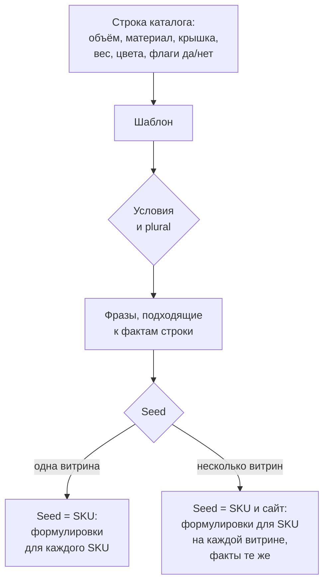

# Описания для тысяч SKU: дубли, Google и шаблон

Что Google говорит об одинаковых описаниях товаров, и 100 SKU четырьмя способами: копия, подстановка и один шаблон с общим seed и с seed на каждый SKU.

Source: https://ru.spintax.site/product-descriptions-for-thousands-of-skus/
Published: 2026-11-05
Facts checked: 2026-11-05

---

Каталог начинается с текста поставщика. Двадцать объёмов и крышек одной бутылки получают один
и тот же абзац, а владелец магазина читает советы вроде этого из блога Shopify, обновлённого
30 января 2026 года:

> Write unique descriptions for every product. Duplicate content across product pages hurts SEO and makes it harder for search engines to decide which page to rank.

Та же статья признаёт цену: «Writing unique descriptions for hundreds or thousands of
products takes time most merchants don’t have.» Прежде чем решать, какими должны быть
уникальные описания товаров для большого каталога, статья проверяет, что про одинаковые описания
товаров говорит сам Google, а затем меряет, что меняется между 100 карточками, когда текст
взят из скопированного абзаца, из подстановки значений и из одного шаблона spintax.

## Что говорит Google, с датами

[SEO Starter Guide](https://developers.google.com/search/docs/fundamentals/seo-starter-guide),
обновлённый 10 декабря 2025 года, отвечает на вопрос о санкциях под заголовком, где само
слово взято в кавычки:

> If you have some content that's accessible under multiple URLs, it's fine; don't fret about it. It's inefficient, but it's not something that will cause a manual action. Copying others' content, however, is a different story.

[Страница о канонизации](https://developers.google.com/search/docs/crawling-indexing/canonicalization)
(20 августа 2026 года) говорит то же о дублях внутри одного сайта, «Some duplicate content on
a site is normal and it's not a violation of Google's spam policies», и описывает, что Google
с ними делает: «If Google finds multiple pages that seem to be the same or the primary content
very similar, it clusters them together.» Справка
[отчёта об индексировании](https://support.google.com/webmasters/answer/7440203) говорит о
странице, которую Google уже счёл дублем, «Google does not serve duplicate pages», и о том, что
делать, если это не дубль: «ensure that the content differs substantially between the two
pages.»

Для магазина, который сам пишет тексты карточек, дубли карточек товаров в формулировках Google
означают склейку: из группы похожих страниц в поиске показывается одна. Жёсткие слова Google оставляет для
копирования чужих сайтов. Для вариантов одного товара у Google есть своя модель.
[Руководство по URL в ecommerce](https://developers.google.com/search/docs/specialty/ecommerce/designing-a-url-structure-for-ecommerce-sites)
просит отдельный URL на каждый вариант, а
[документация по вариантам товара](https://developers.google.com/search/docs/appearance/structured-data/product-variants)
делит текст:

> A common title and description are specified at the ProductGroup level. Variant-specific titles and descriptions are specified at the Product level.

Там же Google просит, чтобы «the variant description is more specific and ideally uses words
that identify the variant (such as color, size, material)». А страница о полезном контенте
(5 октября 2026 года) называет короткий путь, в который может превратиться шаблон:
«automatically generating pages from feeds or using generative AI to produce large amounts of
text without manual oversight or curation represents little to no effort.»

## Что эксперт ответил магазину с 30 000 вариаций

В июле 2026 года магазин на WooCommerce примерно с 3 000 товаров и 30 000 вариаций спросил в
[сообществе Search Central](https://support.google.com/webmasters/thread/452914092), почему
один цвет товара попал в индекс, а почти такой же другой нет. Ответ barryhunter, Diamond
Product Expert, 30 июля:

> Google, for better or worse does NOT seek to index everything. It tries to manage bloat, and not index endless variations.

И об очевидном решении — переписывать текст каждого цвета, пока он не станет другим:

> You just adding/changing text to make it very superficially different. It isn't actually making the content any 'better'.

Он добавляет: «If the text can be improved such that a better page for users, that is a noble
goal.» Product Expert — волонтёр, а не Google, и ни в этом треде, ни в других, которые мы
прочли, сотрудники Google не отвечали. Он отвечал магазину, который переписывал свои тексты
вручную, и замер ниже берёт у него различие: страницы отличаются потому, что отличаются
товары, или потому, что поменяли слова.

## Сто SKU, четыре способа

Каталог синтетический: пять линеек бутылок для воды, четыре объёма (350, 500, 750 и 1 000 мл)
и пять крышек, всего 100 SKU. В каждой строке девять полей: объём, материал, термоизоляция
(два значения — сколько часов бутылка держит холод и тепло — либо её отсутствие), крышка,
герметична ли крышка, можно ли мыть её в посудомоечной машине, вес, число цветов и помещается
ли бутылка в автомобильный подстаканник.
Строки различаются так, как различается настоящий ассортимент: термоизолированная стальная
линейка и стеклянная, крышка с трубочкой, которая не держит воду, и винтовая, которая держит.

Четыре пула по 100 описаний, по одному на SKU:

- **copied**: абзац линейки, один и тот же на всех 20 SKU линейки;
- **merge**: одна фраза-рамка, в которую подставлены значения строки, без вариантов и условий;
- **one seed**: шаблон ниже, все SKU отрендерены с одним и тем же seed;
- **per SKU**: тот же шаблон, каждый SKU отрендерен со своим артикулом в качестве seed.

Сходство — лексическое, как в [статье про scaled content abuse](/scaled-content-abuse-and-spintax/):
цепочки по пять слов, коэффициент Жаккара для каждой пары, затем среднее. «В линейке» усредняет только
пары из одной линейки, где страницы ближе всего друг к другу. «Верно» — число строк из 100, в которых
каждое из девяти полей совпадает со строкой каталога: значение, которое у строки есть, названо
в предложении без отрицания, и другого значения того же рода из каталога в тексте нет;
свойство, которое у строки есть, названо так же; свойство, которого нет, не упоминается.
Утверждения за пределами девяти полей не оцениваются: скопированные абзацы говорят «hard to
break» и «protects it from knocks», и ничего здесь этого не проверяет.

| Пул | Сходство | В линейке | Верно |
| --- | --- | --- | --- |
| copied | 0.217 | 1.000 | 0 |
| merge | 0.108 | 0.236 | 3 |
| one seed | 0.116 | 0.243 | 100 |
| per SKU | 0.072 | 0.128 | 100 |

Каждый из трёх других пулов даёт 100 разных текстов. Скопированный пул — пять текстов на
100 страниц, и ни в одном нет объёма, крышки или веса.
Подстановка разная на каждой странице и всё равно ошибается в 97 строках. Эта подстановка —
одна фраза, которая называет одни и те же поля для каждой строки, поэтому она нигде не
упоминает термоизоляцию, герметичную крышку, посудомоечную машину и подстаканник, а для 17
бутылок, которые продаются в одном цвете, печатает «1 colours». Скрипт подстановки с ветвлением по этим полям справился бы
лучше, но тогда он делал бы вручную то, что делают условия шаблона.

С одним seed для всех SKU случайные выборы на каждой странице одинаковы, и текст меняют только
значения строки и условия. Сходство, 0.116, близко к 0.108 у подстановки. Все строки при этом
верны, потому что условия называют каждый факт только там, где он есть у строки, а plural
выбирает форму. Seed по SKU затем снижает сходство до 0.072, а внутри линейки с 0.243 до
0.128, при тех же фактах на каждой странице. В нашем прочтении это второе снижение — разница
того рода, который эксперт назвал поверхностным. Метрика одинаково награждает оба снижения, и
статья про scaled content abuse нашла то же в оценках уникальности.

## Шаблон

Сначала было одно готовое описание, для Kestrel 750 Sport, а разметка появилась в конце —
порядок [реверс-авторинга](https://spintax.net/docs/authoring-mindset/). Это тот файл, который
рендерит замер, как он есть:

```
#def %Bottle% = {water bottle|bottle}
{The %name% is a %capacity% ml %Bottle% made of %material%|Meet the %name%, a %capacity% ml %Bottle% made of %material%|%name%: a %capacity% ml %Bottle% in %material%}. [<sep=" ">{?insulated?{It keeps drinks cold for %cold% hours and hot for %hot%|Drinks stay cold for %cold% hours and hot for %hot%}.}|{The %lid% lid|Its %lid% lid} {?leakproof?{is leak-proof|seals without leaks}{?dishwasher? and {goes in|can go in} the dishwasher}|{?dishwasher?{goes in|can go in} the dishwasher|is washed by hand}}.|{It weighs %weight% g|Its weight is %weight% g}{?cupholder? and it fits most car cup holders}.] {It comes in %colours% {plural %colours%: colour|colours}|%colours% {plural %colours%: colour is|colours are} available}.
```

Что делает каждая часть и какой гайд на spintax.net её разбирает:

- `%name%`, `%capacity%` и остальные приходят из строки в момент рендера. Какие факты
  принадлежат строке, какие сайту, а какие шаблону, — тема гайда о
  [переменных](https://spintax.net/docs/variables/).
- `{?leakproof?…|…}` называет факт только для строк, у которых он есть. Флаги передаются как
  `1` или пустая строка, потому что условие проверяет, пусто ли значение; таблица — в гайде об
  [условном spintax](https://spintax.net/docs/conditional-spintax/).
- `{plural %colours%: colour|colours}` — то, чего не хватило подстановке. Гайд о
  [согласовании с числом](https://spintax.net/docs/plural-spintax/) разбирает три формы,
  которые нужны в русском языке: на нём каталог ломается первым.
- `#def`, а не `#set`: `#def` разрешается один раз за рендер, поэтому бутылка называется одним
  словом во всех предложениях одной страницы. Переменная `#set` перевыбирается при каждом
  использовании — [ловушка перевыбора](https://spintax.net/docs/variables/#reroll).
- Квадратные скобки перемешивают предложения в середине описания,
  [перестановки](https://spintax.net/docs/permutations/).
- Seed — это артикул, поэтому текст становится адресом: повторный рендер всех 100 SKU дал 100
  текстов, и каждый совпал с прежним; страница не меняется, когда каталог пересобирают.

Чтение выборки рендеров поймало две вещи, которые не поймала бы ни одна проверка. «Choose from
1 colour» грамматически верно, но звучит странно, и этот вариант ушёл. «At 310 g, it is light to
carry» попало на стеклянную бутылку; это утверждение было моим, а не строки каталога, и оно
тоже ушло. [Гайд по починке шаблонов](https://spintax.net/docs/repairing-spintax/) — каталог
дефектов, которые видны только в сочетании веток.

Один шаблон на все товары работает, пока товары устроены одинаково. Страница, собранная из
частей, строится по [композиции шаблонов](https://spintax.net/docs/template-composition/):
шаблон элемента на каждую запись данных или SKU, шаблоны разделов, которые собирают готовые
элементы, и шаблон страницы сверху. Когда значения приходят из фида поставщика, случайная
фигурная скобка или вертикальная черта в названии товара будет прочитана как разметка;
`neutralize()` в [JavaScript-движке](https://spintax.net/spintax-for-javascript/) экранирует
значение, прежде чем оно попадёт в контекст.

## Варианты и витрины

В модели Google 100 SKU здесь — варианты пяти групп товаров, и различают их объём и крышка. У
каждого свой URL и своё описание, а слова, которые называют вариант, шаблон берёт из строки:
объём и крышку. Цвет — это число в строке, а не отдельная страница. Красная и синяя бутылка
одного объёма отличались бы одним словом, и переписывать синюю страницу, пока она не станет
непохожей на красную, — это, в нашем прочтении треда, то изменение, о котором предупреждал
эксперт.

Несколько витрин с одним каталогом — другой случай, и
[гайд по n8n](https://spintax.net/spintax-for-n8n/) кладёт для него сайт в seed. С seed
`sku:site-a` и `sku:site-b` два текста одного SKU имели сходство 0.292, и ни одна из 100 пар
не совпала. Факты в обоих текстах одинаковые, так что это разница только в формулировках, а добавляют
ли что-то два магазина с одним каталогом — вопрос к самим магазинам.



## Где ручной путь заканчивается

Замер — три файла: [catalogue.mjs](/measurements/thousand-skus/catalogue.mjs) держит
синтетические строки и правила, по которым они построены,
[template.txt](/measurements/thousand-skus/template.txt) — шаблон выше, а
[measure.mjs](/measurements/thousand-skus/measure.mjs) печатает все измеренные результаты из
статьи и каждый SKU, который отмечают его проверки, предварительно убедившись, что проверки
пропускают два верных текста и отклоняют 16 заведомо неверных:

```bash
npm install @spintax/core@0.14.0
node measure.mjs
```

В настоящем магазине шаблон должен встретиться с каталогом там, где каталог живёт.
[Плагин Spintax для WordPress](https://wordpress.org/plugins/spintax/) подтягивает данные
товаров WooCommerce в шаблон и записывает результат по каждому товару: при сохранении, по cron
или через Bulk Apply. [Расширение для OpenCart](https://github.com/investblog/spintax-opencart)
делает то же для описаний и мета-тегов OpenCart, с пробным прогоном до записи. Фид товаров в
таблице или базе проходит через [ноду n8n](https://spintax.net/spintax-for-n8n/), по рендеру
на строку, с проверкой уникальности на пуле.

Если черновик шаблона пишет модель, в руководстве
[AI spintax templates](https://spintax.net/ai-spintax-templates/) есть промпт и проверки, а
правила написания шаблонов приходят в виде скила для агента с одним каноническим источником,
spintax.net: `npx skills add https://spintax.net`. Скил обновляется вместе с движком;
синтаксис `/! … !/`, который `@spintax/core` 0.14.0 добавил 19 октября 2026 года, в нём уже
есть. Повторная установка держит агента на конструкциях текущего релиза.

Что бы ни написала модель, шаблон становится вашим текстом на шаге, где вы читаете и
переписываете его ветки, а поскольку модели Claude маркируют свой текст водяным знаком,
у этого шага появилась ещё одна причина — об этом
[статья про водяной знак](/claude-text-watermark-and-spintax-templates/).
[Spintax Studio](https://spintax.studio/) — бесплатный редактор для Windows под этот шаг:
шаблон слева, текст, который он даёт, справа, так что каждую переписанную ветку вы читаете в
том предложении, куда она попадает.
